  

  
  
  
  

<table>
  <tr>
    <td width="50%" valign="top">
      <b>&gt; STATUS</b> 
      Building backend systems on <b>.NET</b> with a <b>React</b> front.  
      <b>&gt; TRAINING</b> 
      Going deeper into <b>.NET</b>, <b>React</b> and <b>DevOps</b>.
    </td>
    <td width="50%" valign="top">
      <b>&gt; FIELD NOTES</b> 
      Writing everything I learn into the <a href="https://m1re.github.io/EngineeringVault">Engineering Vault</a>.  
      <b>&gt; INTEL</b> 
      Apple ads show <b>9:41</b>: the minute Steve Jobs unveiled the first iPhone.
    </td>
  </tr>
</table>

<table>
  <tr>
    <td width="50%"></td>
    <td width="50%"></td>
  </tr>
</table>

LATEST ENTRIES FROM THE <a href="https://m1re.github.io/EngineeringVault">ENGINEERING VAULT</a> // AUTO-SYNCED NIGHTLY

<!-- FIELD-LOG:START -->
<table width="100%">
<tr><th align="left">DATE</th><th align="left">ENTRY</th><th align="left">SECTOR</th></tr>
<tr><td><code>2026-11-09</code></td><td><a href="https://m1re.github.io/EngineeringVault/Architecture/Reliability/Idempotency"><b>Idempotency</b></a></td><td><code>Architecture / Reliability</code></td></tr>
<tr><td><code>2026-11-09</code></td><td><a href="https://m1re.github.io/EngineeringVault/Programming/CSharp/Const-vs-Readonly"><b>const vs readonly</b></a></td><td><code>Programming / CSharp</code></td></tr>
<tr><td><code>2026-11-09</code></td><td><a href="https://m1re.github.io/EngineeringVault/Programming/Concurrency/Async-and-Await"><b>Async/Await</b></a></td><td><code>Programming / Concurrency</code></td></tr>
<tr><td><code>2026-11-09</code></td><td><a href="https://m1re.github.io/EngineeringVault/Programming/Concurrency/Concurrency-vs-Parallelism"><b>Concurrency vs Parallelism</b></a></td><td><code>Programming / Concurrency</code></td></tr>
<tr><td><code>2026-11-09</code></td><td><a href="https://m1re.github.io/EngineeringVault/Programming/Concurrency/Threads-and-the-Thread-Pool"><b>Threads and the Thread Pool</b></a></td><td><code>Programming / Concurrency</code></td></tr>
<tr><td><code>2026-11-09</code></td><td><a href="https://m1re.github.io/EngineeringVault/Programming/Runtime/Value-vs-Reference-Types"><b>Value vs Reference Types</b></a></td><td><code>Programming / Runtime</code></td></tr>
</table>
<!-- FIELD-LOG:END -->

  

