

  

  
  
  
  
  
  




<table>
  <tr>
    <td width="50%"><a href="https://github.com/M1re/EngineeringVault"></a></td>
    <td width="50%"><a href="https://github.com/M1re/HighPriority"></a></td>
  </tr>
  <tr>
    <td width="50%"><a href="https://m1re.github.io"></a></td>
    <td width="50%"></td>
  </tr>
</table>





<a href="https://m1re.github.io/EngineeringVault">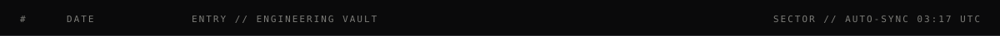</a>

<!-- FIELD-LOG:START -->
<a href="https://m1re.github.io/EngineeringVault/Architecture/Reliability/Idempotency"></a>
<a href="https://m1re.github.io/EngineeringVault/Programming/CSharp/Const-vs-Readonly"></a>
<a href="https://m1re.github.io/EngineeringVault/Programming/Concurrency/Async-and-Await"></a>
<a href="https://m1re.github.io/EngineeringVault/Programming/Concurrency/Concurrency-vs-Parallelism"></a>
<a href="https://m1re.github.io/EngineeringVault/Programming/Concurrency/Threads-and-the-Thread-Pool"></a>
<a href="https://m1re.github.io/EngineeringVault/Programming/Runtime/Value-vs-Reference-Types"></a>
<!-- FIELD-LOG:END -->


  

